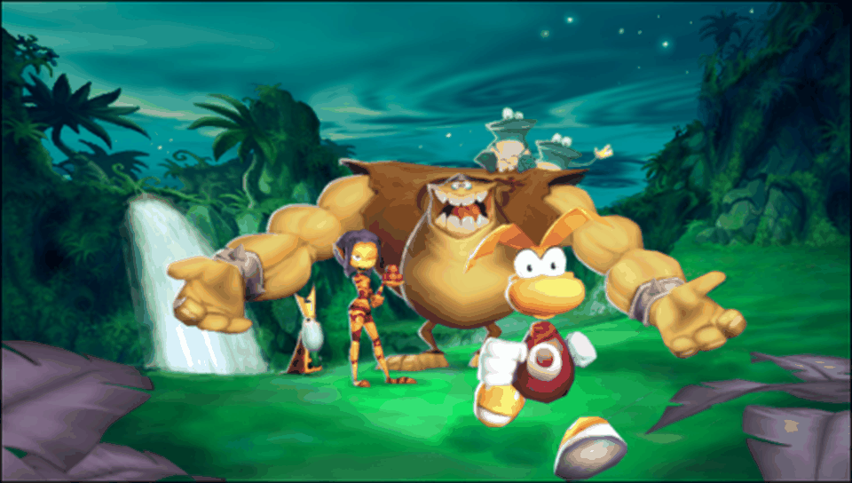

<h1 align="center">
  <br>
  Rayman 2 The Great Escape · PS Vita Port
</h1>

<p align="center">
  <a href="#-status--playability">Status & Playability</a> •
  <a href="#setup-instructions-for-players">How to install</a> •
  <a href="#controls">Controls</a> •
  <a href="#known-issues">Known Issues</a> •
  <a href="#build-instructions-for-developers">How to compile</a> •
  <a href="#credits--acknowledgments">Credits</a>
</p>

An unofficial, native **iOS-to-PS Vita wrapper port** of *Rayman 2: The Great Escape* (originally developed by **Ubisoft**, iOS version by **Gameloft**). There is no `.so` here: this port ships its own **Mach-O loader** that maps the official iOS ARM executable (`Rayman2`, from the 1.0.1 IPA) into PS Vita RAM and replaces the Apple frameworks it uses (Foundation, UIKit, OpenGL ES, CoreAudio / AudioToolbox, OpenAL) with native implementations on top of **vitaGL**, **libopusfile** and the Vita system libraries.

---

## 🎮 Status & Playability

**Status: Playable (v1.0)**

The game boots on physical PlayStation Vita hardware and is playable from the Gameloft logo and title screen through the main menu, the in-engine intro and the first levels, with graphics, music and sound.

- [x] **Mach-O loader**: loads the iOS ARM executable at a fixed base (`MACHO_SLIDE = 0x98000000`), applies **8,505** rebase words, resolves **629** import slots (0 unimplemented) and runs the **0** global constructors the binary has. *Verified on console.*
- [x] **Graphics**: GLES 1.1 → **vitaGL** (`SOFTFP_ABI=1`). The game renders into a 320×480 framebuffer that is rotated onto the Vita's 960×544 screen. Logos, loading screens, title screen, menu text, HUD and 3D levels render correctly. *Verified on console.*
- [x] **Performance**: a steady **60 fps** in the menu and in game (600 frames every 10 s in the console logs). *Verified on console.*
- [x] **Audio**: music (`.BGM`, re-encoded to Ogg Opus at staging time) and sound effects (OpenAL). *Verified on console.*
- [x] **Touch & Controls**: front touchscreen plus a full physical button mapping (see [Controls](#controls)). *Verified on console.*
- [x] **Hidden touch controls**: the on-screen stick and the red / blue action buttons are hidden (0% opacity) by default; **L + R** shows / hides them, and the choice is saved.
- [x] **Language**: the game starts in **English**; other languages can be picked in the game's own options.
- [x] **Saves**: iOS `Documents/` is redirected to `ux0:data/rayman2thegreatescape/saves/` (`RAYMAN_2_SY_` options file and game slots).
- [x] **Offline bypasses**: "MORE GAMES!" (Gameloft online shop) does nothing by design.

---

## Disclaimer

**Rayman** is a registered trademark of **Ubisoft Entertainment**. The work presented in this repository is unofficial and is not produced, endorsed, or sanctioned by Ubisoft, Gameloft or any affiliated entities.

This software does NOT contain original game code, binaries, copyrighted graphics, or game assets. The authors do not promote or condone piracy in any way. To play, you must provide your own legally obtained, **decrypted** copy of the iOS `.ipa`.

---

## Setup Instructions (For Players)

1. **CFW & Plugins**: PS Vita on Custom Firmware (**Enso 3.60 / 3.65** recommended) with `kubridge` under `*KERNEL` in `ur0:tai/config.txt`:
   ```ini
   *KERNEL
   ur0:tai/kubridge.skprx
   ```
2. **Shader Compiler**: `libshacccg.suprx` must be in `ur0:data/` (extract it with **ShaRKBR33D**).
3. **Game Files**: a decrypted **Rayman 2 The Great Escape 1.0.1** iOS `.ipa` (FairPlay `cryptid 0`). Open it as a ZIP and extract `Payload/Rayman2.app/`.
4. **Convert the music** (on a PC, once): the `.BGM` music files are AAC and the loader plays Ogg Opus. Run `tools/stage_data.sh /path/to/Rayman2.app` from this repository (needs `python3`, `rsync` and `ffmpeg` with `libopus`); it builds `ux0_data/rayman2thegreatescape/` with the converted bundle and `rebase.bin`.
5. **Copy to the Vita** (`ux0:data/rayman2thegreatescape/`):
   ```
   ux0:data/rayman2thegreatescape/
     game_app/      the contents of Rayman2.app (executable + DATA/), music converted by stage_data.sh
     rebase.bin     generated from the executable (also attached to each release)
     controls.txt   created automatically — physical button mapping
     saves/         created automatically — your save games and loader_settings.txt
     logs/          created automatically — rayman2thegreatescape_001.log … one per run
   ```
6. **Install VPK**: install `rayman2thegreatescape.vpk` with VitaShell.

---

## Controls

Physical buttons are translated into touches on the game's own on-screen buttons. The mapping can be edited in `ux0:data/rayman2thegreatescape/controls.txt`.

| Input | Action |
| :---: | :--- |
| **Front Touchscreen** | Full touch UI (menus, HUD) |
| **Left Stick / D-Pad** | Move Rayman (virtual stick) |
| **Right Stick** | Camera |
| **Cross (✖)** | Jump (blue button) |
| **Square (◼)** | Shoot magic fist (red button) |
| **Circle (●)** | On-screen button 3 (right, above the red button) |
| **Triangle (▲)** | On-screen button 6 (top-left) |
| **L** | On-screen button 2 (left, look button) |
| **Start** | Pause |
| **Select** | Display mode: 816×544 (original aspect) ↔ 960×544 (stretched) |
| **L + R** | Show / hide the on-screen stick and red / blue buttons (hidden by default) |

---

## Display Modes

| Mode | Image | Borders |
| :--- | :--- | :--- |
| **816×544 (default)** | Original 3:2 aspect | Black bars on the left and right |
| **960×544** | Stretched to 16:9 | None |

**Select** switches between them; the choice is saved in `saves/loader_settings.txt`. Touch input follows the active mode.

---

## Known Issues

- **Language**: the game always starts in English; the Vita system language is not used (picking it automatically showed the wrong language).
- **Online features disabled**: "MORE GAMES!" (Gameloft shop) is bypassed by design.
- **Hidden touch controls and saves** have not yet been checked in a long play session on console.
- **Crash dumps** are written by the system to `ux0:data/` (not to the game folder).

---

## Build Instructions (For Developers)

### Prerequisites

- [VitaSDK](https://vitasdk.org/) (`$VITASDK`) with `vitaGL` (vendored), `vitashark`, `libopusfile`, `openal-soft`, `freetype`, `libpng` and `zlib`.
- CMake 3.14+, Python 3, `rsync` and `ffmpeg` with `libopus` (for the tools).
- The decrypted `Rayman2.app` folder, linked as `game_app` in the repo root (never committed).

### Compilation Commands

```bash
git clone https://github.com/MetalSyntax/Rayman-2-The-Great-Escape-vita.git
cd Rayman-2-The-Great-Escape-vita
ln -s /path/to/Payload/Rayman2.app game_app

# Stage the console data (copies the .app, converts the music + generates rebase.bin)
tools/stage_data.sh

# Build eboot.bin / rayman2thegreatescape.vpk
cmake -S . -B build
cmake --build build
```

### Deploy & Debug (over VitaShell FTP)

```bash
python3 -I tools/deploy_data.py          # incremental upload of ux0_data/rayman2thegreatescape/ (never touches saves/)
python3 -I tools/deploy_data.py --logs   # fetch logs and crash dumps into ./logs/
```

A crash PC in `0x98xxxxxx` minus `0x98000000` is the address in the Mach-O: inspect it with `python3 -I tools/annotate.py game_app/Rayman2 <symbol>`. The loader can also run on a PC (Docker, Linux ARM32): see `hosttest/run.sh`. Architecture and progress notes: [`PORTING_PLAN.md`](PORTING_PLAN.md).

---

## ☕ Support My Work

This project is **free** and will stay free. If you enjoy it, a tip from **$1** helps me keep porting games to the PS Vita:

<p align="center">
  <a href="https://ko-fi.com/metalsyntax"></a>
</p>

- **Ko-fi:** [ko-fi.com/metalsyntax](https://ko-fi.com/metalsyntax)
- **PayPal:** [paypal.me/MetalSyntax](https://paypal.me/MetalSyntax)
- **Bitcoin (BTC):** `133HdCsaWxdjTfmwpgGVykByhNBV338uRc`

**Ko-fi supporters get:**
- **Early access** to new ports before their public release (test builds of upcoming projects).
- **Data preparation scripts and step-by-step guides** to set up your own game files for each new port.
- A say in which games I port next.

> Game files are never distributed. You always need your own legally obtained copy of the game.

---

## Credits & Acknowledgments

- **Rayman 2: The Great Escape** is intellectual property of **Ubisoft Entertainment**; the iOS version was published by **Gameloft**.
- **vitaGL** graphics library by [Rinnegatamante](https://github.com/Rinnegatamante/vitaGL).
- **kubridge** plugin by [Bythos](https://github.com/bythos14/kubridge).
- **Opus / libopusfile**, **OpenAL Soft**, **FreeType**, **libpng** and **zlib** projects.
- The **iOS Mach-O loader** is based on [`ios-loader-boilerplate`](https://github.com/MetalSyntax/ios-loader-boilerplate) and the [`Inotia2-vita`](https://github.com/MetalSyntax/Inotia2-vita) port.
- Special thanks to the PS Vita homebrew and porting community.
